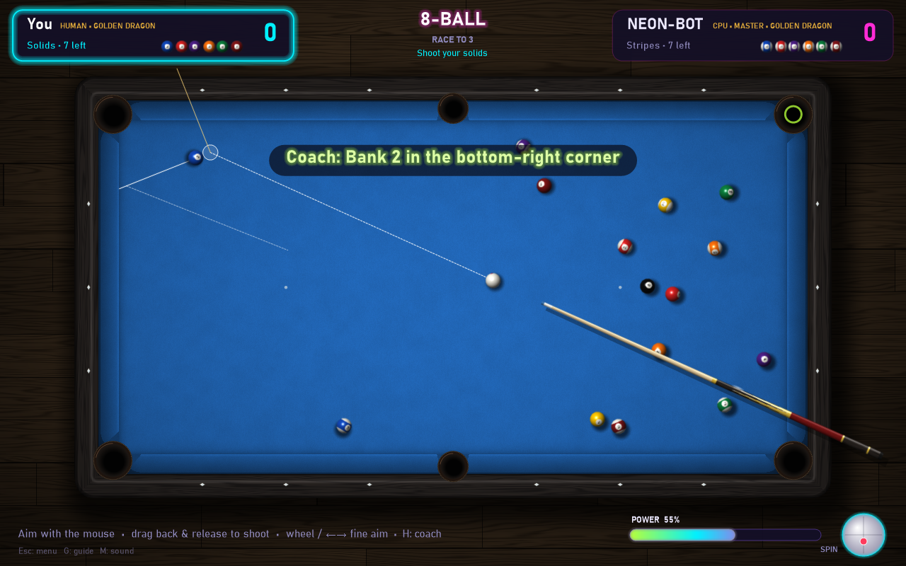
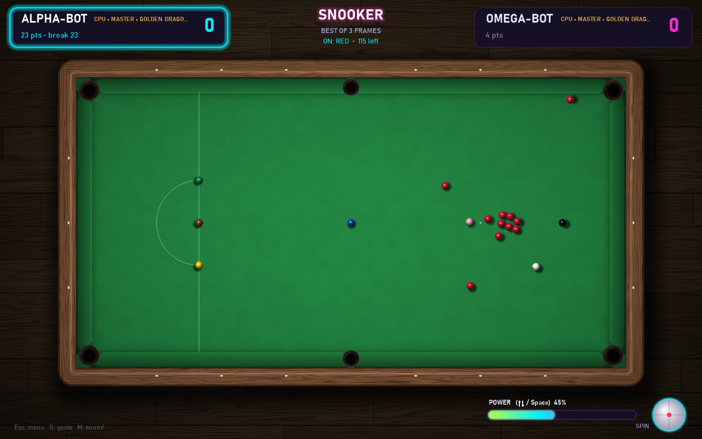
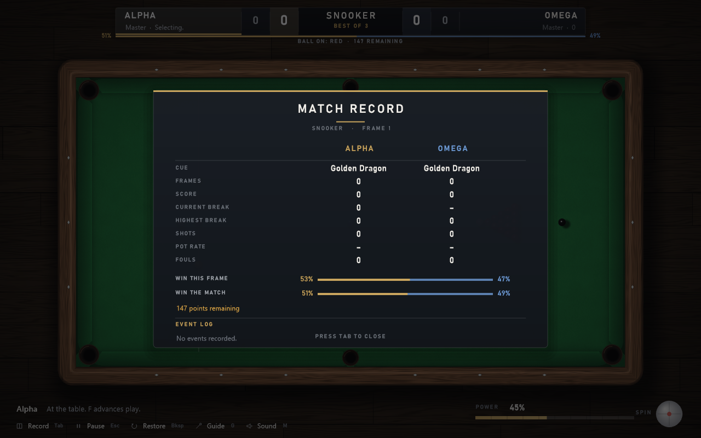
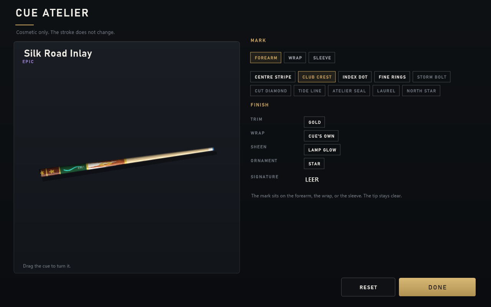

# Neon Cue

A billiards game for Windows, written in C# (.NET 8, WinForms + GDI+, no external packages). It has a photorealistic table and a clean, broadcast-style interface (charcoal panels, gold and steel-blue accents); the original neon table is still available as a table style.
It has six game modes, four AI levels and a deterministic physics engine. The AI plans its shots by
playing them out in that same engine.








## Download and play

1. Open the [latest release](../../releases/latest) and download **`NeonCue-win-x64.zip`**.
2. Unzip it anywhere and run **`NeonCue.exe`**. Nothing else is needed: .NET is bundled, and there is no installer.
3. The game is not code-signed yet, so Windows may warn you the first time. On the blue SmartScreen dialog, click **More info → Run anyway**. If **Smart App Control** is on, Windows blocks unsigned apps completely. You can only run the game with it switched off (Windows Security → App & browser control).

Releases are built on GitHub Actions; see the [Code signing policy](#code-signing-policy). Settings, coins and cues are saved in `%AppData%\NeonCue`. If the game ever crashes, the details are written to `crash.log` in the same folder.

## Features

- **7 game modes**: 8-Ball, 9-Ball, 10-Ball, Straight Pool (14.1-style, endless re-racks), Rotation 61, solo Practice, and **Snooker**.
- **Snooker**:
  - A full 12-ft table: smaller 52.5 mm balls, tighter pockets, the baulk line and D, and colour spots.
  - 15 reds and six colours, played red, then a colour. Colours are respotted while reds remain, then taken in order.
  - Fouls award at least 4 points, and an in-off gives the opponent ball in hand in the D. Matches are played as best-of frames.
  - The HUD shows the ball on, the current break, points remaining, and a *snookers needed* warning.
  - The AI picks colours by value (it goes for the black), plays safety, opens with a safe break-off rather than a power break, and concedes frames it can no longer win.
- **Opponents**: you vs CPU, 2 players on one PC (hot seat), or CPU vs CPU (watch mode).
- **4 AI levels**: Rookie, Amateur, Pro and Master. Each level searches more shots and has a steadier stroke than the one below.
- **Cue shop**: 12 cues from a free House Cue to the 50,000-coin Black Diamond Royale. Every stat changes the physics (see below). You earn coins by potting balls and beating the CPU.
- **AI coach**: press **H** and the AI suggests a shot for you (aim, power and spin), ready to fire with Space.
- **Real physics** (validated against textbook billiards results on every build):
  - Every ball has a 3-D spin vector. It slides on the cloth (μ 0.2), then rolls (μ 0.01) at 5/7 of its speed after a centre-ball hit.
  - Draw, follow and stun come from the spin itself.
  - Ball-to-ball friction follows Alciatore's measured fit, which produces real cut- and spin-induced **throw**.
  - Cushions grip a spinning ball, so english changes the rebound.
  - Squirt from side spin, and pocket jaws that can rattle a ball out.
- **Exact aim prediction**: the guide doesn't draw ghost-ball geometry. It plays the shot in the physics engine in the background and draws the real paths: the cue ball to contact, the object ball (throw included), the cue ball's path afterwards (draw and follow curves), where each ball stops, a green pocket when the ball drops, and a red **SCRATCH** warning. With stroke error off (the default), the ball goes exactly where the guide shows.
- **Smooth motion on high-refresh monitors**:
  - The game loop is paced to the monitor's refresh rate instead of a coarse timer.
  - Each ball is drawn between its last two physics positions (fixed 1/480 s steps), so motion stays even at any frame rate.
  - Ball sprites are rendered in parallel at quarter-pixel precision and copied 1:1 (no resampling).
  - Measured with `NeonCue.exe --bench`: frame cost fell from 15.6 ms to 5.2 ms, and motion unevenness from 29% to 3%.
- **Smart scoreboard (Tab)**: per-player frames or racks, score, current and best break or run, shots, pot success and fouls; live **win chances** for the rack/frame and the match (based on the score, what is left on the table, who is at the table and player skill); points left in snooker; and a match log. A slim win-chance bar sits under the match title.
- **Aim guides**: off, ghost ball, or full prediction (object-ball path, cue-ball tangent, and a highlight on the target pocket).
- **Smart aiming**:
  - **Aim assist** (menu: Off / Light / Strong): when the cursor rests, an aim within a few pixels of a potting line snaps onto it exactly. It never acts while you are moving, so the cue stays free.
  - **Power preview**: the aimed shot is simulated at 20 power levels in the background. Green ticks on the power bar show which powers pot the ball. The pocket lights green only when the current aim *and* power pot it, and amber when the line is right but the power isn't, with a marker where the ball would stop.
- **Match options**: race to 1/3/5/7/9, straight-pool target 25–150, ball in hand, three-foul rule, and an 8-ball break that must go from the kitchen after a scratch.
- **Realistic graphics, all generated in code (no image files)**:
  - Balls are rendered as 3D spheres with lighting and reflections. They roll and turn as they move, carry numbers on both sides, and the 6 and 9 are underlined.
  - The table has varnished wood rails with grain, lamp-lit cloth with fibre texture, felt-covered cushions, leather pockets, mother-of-pearl diamonds and an oak floor that catches the table's shadow.
  - Each cue is built from its materials: maple or carbon-fibre shafts; walnut, ebony, cocobolo or purpleheart forearms; inlaid points; linen, leather or snakeskin wraps; and gold or silver rings.
- **Table styles**: Classic green, Tournament blue, Royal burgundy, or Neon (glowing rails, particle bursts).
- **Sound**: synthesized in code, so there are no audio files. A built-in mixer plays every hit on its own voice, so on the break dozens of clicks overlap naturally. Loudness follows impact speed, stereo panning follows the ball's position, and pitch varies slightly per hit. There is no background noise, only the knocks.
- **Each cue has its own strike sound**, shaped by its materials: a dull wooden knock (House Cue), a clean maple tock (Starter), a sharp phenolic crack (Thunder Breaker), a glassy carbon tick (Carbon Phantom), and rich knocks with a ringing finish from gold or diamond fittings (Golden Dragon, Black Diamond Royale). Picking a cue in the shop plays its sound.

## Cues

| Cue | Tier | Price | Speed | Spin | Wobble | Deflection | Draw | Perks |
|---|---|---:|---:|---:|---:|---:|---|---|
| House Cue | Common | free | ×0.90 | ×0.70 | ±0.25° | 1.6° | Even | — |
| Neon Starter | Common | 500 | ×0.95 | ×0.85 | ±0.18° | 1.35° | Even | — |
| Ash Linen | Common | 800 | ×0.88 | ×0.95 | ±0.12° | 1.2° | Soft | Feather touch |
| Violet Viper | Rare | 1,500 | ×1.00 | ×1.08 | ±0.15° | 1.05° | Even | — |
| Bank Ivory | Rare | 2,400 | ×0.97 | ×0.92 | ±0.09° | 0.95° | Even | Eagle Eye |
| Thunder Breaker | Rare | 3,200 | ×1.14 | ×0.82 | ±0.20° | 1.25° | Heavy | Break boost +24% |
| Carbon Phantom | Epic | 6,000 | ×1.02 | ×1.12 | ±0.08° | 0.32° | Even | Low deflection |
| Helix Carbon | Epic | 7,800 | ×1.00 | ×1.16 | ±0.07° | 0.26° | Even | Low deflection |
| Silk Road Inlay | Epic | 12,000 | ×1.03 | ×1.28 | ±0.05° | 0.72° | Soft | Feather touch |
| Aurora Crystal | Legendary | 18,000 | ×0.98 | ×1.20 | ±0.04° | 0.5° | Soft | Eagle Eye |
| Golden Dragon | Legendary | 25,000 | ×1.06 | ×1.30 | ±0.03° | 0.42° | Even | Low deflection, Eagle Eye |
| Black Diamond Royale | Mythic | 50,000 | ×1.05 | ×1.26 | ±0.02° | 0.38° | Soft | Low deflection, Eagle Eye |

- **Draw** is how the pull maps onto power: a *soft* cue stays gentle for longer (for touch shots), a *heavy* cue reaches full speed sooner (for breaking). **Feather touch** keeps soft strokes almost wobble-free.
- **Cue Atelier**: dress any cue you own with marks on the forearm, wrap or sleeve, a trim, a wrap, a sheen, a butt ornament and a short signature. It is purely cosmetic; the stroke does not change. Extra mark sets can be bought with coins.
- **Speed** scales the cue ball's top speed, and **Spin** scales how much follow, draw and english it carries.
- **Wobble** is random stroke error at full power. Soft shots wobble only 30% as much, and a faint cone on the aim line shows the spread at your current power. A weaker cue also magnifies the CPU's own aiming error.
- **Deflection** ("squirt") is how far side spin pushes the cue ball off the stick line. The aim guide shows the real launch line, so you can see it.
- **Aim vision** sets how long the guide lines are. **Eagle Eye** also draws the bounce off the first cushion.
- **Coach pick**: the shop marks the best cue you own or can afford for the selected game mode. Each mode weights the stats differently; for example, 9-Ball favours break power and Straight Pool favours accuracy.
- **CPU cues**: CPU players use cues that match their level: Rookie gets the House Cue, Amateur the Violet Viper, Pro the Carbon Phantom and Master the Golden Dragon.
- **Coins**: +5 per ball you pot vs the CPU (+2 in practice). Winning a rack pays 60 × the CPU level (Rookie = 1 … Master = 4), and winning the match adds 100 × the CPU level. Losing a rack still pays +15. Two-player games pay nothing.

Same AI and level, different cue (`tests/NeonCue.Sim -- cues 40`, Pro vs Pro): Black Diamond Royale beat the House Cue in 27/40 racks, Carbon Phantom beat the Neon Starter in 26/40, and Violet Viper beat the House Cue in 22/40.

## How the AI thinks

1. **Candidate shots**: for every legal target it computes the ghost-ball line into each pocket and rejects blocked paths and impossible cut or approach angles. Pro and Master also add combinations and one-rail banks.
2. **Simulation**: each candidate is tried with several powers and spins in the real physics engine, and the real rules judge the result (foul, keeps the turn, wins, loses).
3. **Position play**: when a shot keeps the turn, it is scored by how good the *next* shot will be from where the cue ball stops.
4. **Robustness (Pro/Master)**: the best options are replayed with small aim and power errors, so a reliable pot beats a fragile one.
5. **Safety play**: if no pot is reliable enough, the AI searches for the shot that leaves the opponent the worst table.
6. **Ball in hand and break**: it tests many cue-ball placements, and the strongest levels also try several break positions and pick the best.
7. **Stroke error**: the level's aim and power noise is added only when the shot is executed, which is what separates a Rookie from a Master.

Headless benchmark (`tests/NeonCue.Sim`, CPU vs CPU), share of non-break shots that pot a ball:

| Level   | 8-Ball | 9-Ball | Straight Pool |
|---------|-------:|-------:|--------------:|
| Rookie  | ~27%   | ~30%   | ~35%          |
| Amateur | ~31%   | ~39%   | ~42%          |
| Pro     | ~63%   | ~59%   | ~69%          |
| Master  | ~90%   | ~73%   | ~90%          |

## Controls

| Action | Input |
|---|---|
| Aim | The cue follows the mouse freely as you sweep around the cue ball. Moving in to grab the cue ball doesn't change the aim |
| Precise aim | Hold Ctrl and move the mouse: the cue turns at a tenth of the normal speed |
| Shoot | Press anywhere (on the cue ball or on the target), drag back, release (further = harder) |
| Fine aim | Mouse wheel or ← → (0.03° per step, Shift = 0.23°); stays locked until you aim somewhere else |
| Keyboard shot | ↑ ↓ power, Space to shoot |
| Spin | Click the cue-ball widget (bottom right) or W A S D, R to reset |
| Ball in hand | Move the cue ball, click to place; click it again to pick it up (dragging from it shoots instead) |
| AI coach | H |
| Cue shop (from the menu) | C |
| Aim guide / fast forward / sound | G / F / M |
| Scoreboard | Tab |
| Take back the last shot | Backspace (or Ctrl+Z). Up to eight of your shots; the opponent's reply goes with them |
| Move balls (Practice) | Right-click a ball, move it, click to place. Right-click again to put it back |
| Pause menu | Esc |
| Fullscreen | F11 |

## Build and run

Requires the [.NET 8 SDK](https://dotnet.microsoft.com/download) on Windows.

```bash
dotnet run --project src/NeonCue -c Release
```

Or download `NeonCue-win-x64.zip` from the [Releases](../../releases) page. It is self-contained, so it does not need .NET installed. Unzip it and run `NeonCue.exe`.

### Physics validation

```bash
dotnet run --project tests/NeonCue.PhysicsCheck -c Release
```

Checks natural roll (5/7), sliding distance, stun, draw and follow, the 90° and 30° rules, throw, english off the cushion, energy conservation and determinism. CI fails if any check fails.

### Automated play-test

```bash
src/NeonCue/bin/Release/net8.0-windows/NeonCue.exe --playtest report.txt 100
```

A scripted player drives the real game screen with mouse and keyboard input, behaving like a human hand: it points a few pixels off, pauses on the target, takes a wobbly path to the cue ball, and fine-tunes with the arrow keys. It plays hundreds of set-up pots (close and long shots, with and without spin, with ball in hand) and compares the result with a perfect stroke along the aim guide. CI fails if a perfect cue sinks fewer than 90% of the pots the guide promises. See [docs/playtest-report.txt](docs/playtest-report.txt) for the latest report.

```bash
dotnet run --project src/NeonCue -c Release -- --undo-check
```

Checks that Backspace puts the table, score and coins back, that Practice can move a ball, and that a real match cannot.

### AI and physics test bench

```bash
dotnet run --project tests/NeonCue.Sim -c Release -- 3 all all
dotnet run --project tests/NeonCue.Sim -c Release -- duel 12
```

The first command plays CPU-vs-CPU racks for every mode and level and checks that no ball rests off the table, overlaps another ball or is left moving. The second plays matches between different levels to check that stronger levels win.

## Project layout

```
src/NeonCue.Core     Physics, table geometry, game rules, AI (platform independent)
src/NeonCue          WinForms front end: rendering, menus, HUD, input, sound
tests/NeonCue.Sim    Headless simulator / benchmark
```

## Code signing policy

Free code signing provided by [SignPath.io](https://about.signpath.io), certificate by [SignPath Foundation](https://signpath.org).

Release builds are produced from this repository by the [release workflow](.github/workflows/release.yml) on GitHub Actions. Every signing request is approved by hand.

**Team roles**

- Committers and reviewers: [LeerBox](https://github.com/LeerBox)
- Approvers: [LeerBox](https://github.com/LeerBox)

Changes from anyone outside the team arrive as pull requests and are reviewed before they are merged.

**Privacy policy**

This program will not transfer any information to other networked systems unless specifically requested by the user or the person installing or operating it. Neon Cue has no online features. Settings, coins and cues are stored only on your computer, in `%AppData%\NeonCue`.

## License

MIT. See [LICENSE](LICENSE).
