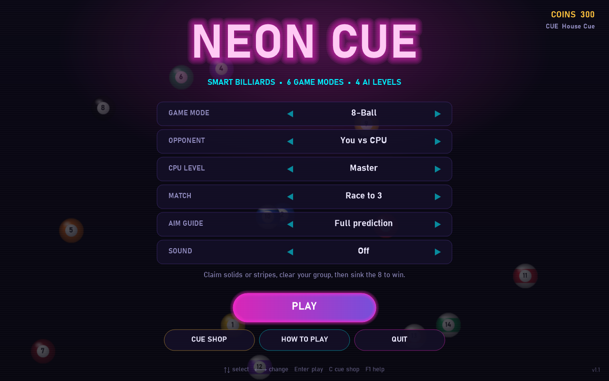
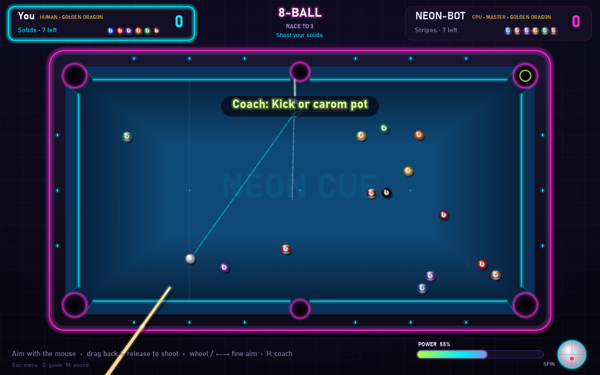
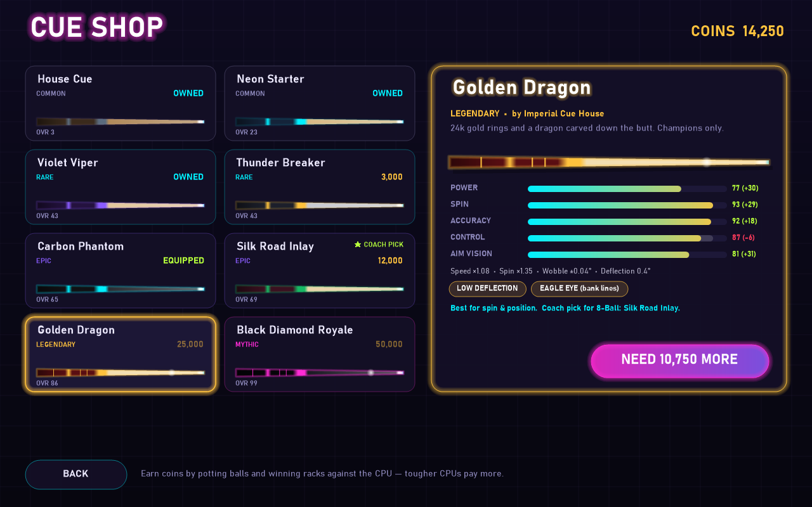

# Neon Cue

A neon-styled billiards game for Windows, written in C# (.NET 8, WinForms + GDI+, no external packages).
It has six game modes, four AI levels and a deterministic physics engine. The AI plans its shots by
playing them out in that same engine.





## Features

- **6 game modes**: 8-Ball, 9-Ball, 10-Ball, Straight Pool (14.1-style, endless re-racks), Rotation 61, and solo Practice.
- **Opponents**: you vs CPU, 2 players on one PC (hot seat), or CPU vs CPU (watch mode).
- **4 AI levels**: Rookie, Amateur, Pro and Master. Each level searches more shots and has a steadier stroke than the one below.
- **Cue shop**: 8 cues from a free House Cue to the 50,000-coin Black Diamond Royale. Every stat changes the physics (see below). You earn coins by potting balls and beating the CPU.
- **AI coach**: press **H** and the AI suggests a shot for you (aim, power and spin), ready to fire with Space.
- **Real physics**: fixed-step ball/ball and cushion collisions, rolling friction, follow/draw and side spin, and pocket jaws that can rattle a ball out.
- **Aim guides**: off, ghost ball, or full prediction (object-ball path, cue-ball tangent, and a highlight on the target pocket).
- **Match options**: race to 1/3/5/7/9, straight-pool target 25–150, ball in hand, three-foul rule, and an 8-ball break that must go from the kitchen after a scratch.
- **Neon look**: glowing rails and pockets, particle bursts, animated menu and synthesized sound (no asset files).

## Cues

| Cue | Tier | Price | Speed | Spin | Wobble | Deflection | Perks |
|---|---|---:|---:|---:|---:|---:|---|
| House Cue | Common | free | ×0.90 | ×0.70 | ±0.50° | 1.6° | — |
| Neon Starter | Common | 500 | ×0.95 | ×0.85 | ±0.36° | 1.35° | — |
| Violet Viper | Rare | 1,500 | ×1.00 | ×1.05 | ±0.25° | 1.05° | — |
| Thunder Breaker | Rare | 3,000 | ×1.12 | ×0.85 | ±0.30° | 1.2° | Break boost +22% |
| Carbon Phantom | Epic | 6,000 | ×1.02 | ×1.15 | ±0.13° | 0.3° | Low deflection |
| Silk Road Inlay | Epic | 12,000 | ×1.04 | ×1.25 | ±0.09° | 0.7° | — |
| Golden Dragon | Legendary | 25,000 | ×1.08 | ×1.35 | ±0.04° | 0.4° | Low deflection, Eagle Eye |
| Black Diamond Royale | Mythic | 50,000 | ×1.10 | ×1.40 | ±0.00° | 0.2° | All three |

- **Speed** scales the cue ball's top speed, and **Spin** scales how much follow, draw and english it carries.
- **Wobble** is random stroke error added to every shot.
- **Deflection** ("squirt") is how far side spin pushes the cue ball off the stick line. The aim guide shows the real launch line, so you can see it.
- **Aim vision** sets how long the guide lines are. **Eagle Eye** also draws the bounce off the first cushion.
- **Coach pick**: the shop marks the best cue you own or can afford for the selected game mode. Each mode weights the stats differently; for example, 9-Ball favours break power and Straight Pool favours accuracy.
- **CPU cues**: CPU players use cues that match their level: Rookie gets the House Cue, Amateur the Violet Viper, Pro the Carbon Phantom and Master the Golden Dragon.
- **Coins**: +5 per ball you pot vs the CPU (+2 in practice). Winning a rack pays 60 × the CPU level (Rookie = 1 … Master = 4), and winning the match adds 100 × the CPU level. Losing a rack still pays +15. Two-player games pay nothing.

Same AI and level, different cue (`tests/NeonCue.Sim -- cues 40`, Pro vs Pro): Black Diamond Royale beat the House Cue in 34/40 racks, Carbon Phantom beat the Neon Starter in 29/40, and Violet Viper beat the House Cue in 30/40.

## How the AI thinks

1. **Candidate shots**: for every legal target it computes the ghost-ball line into each pocket and rejects blocked paths and impossible cut or approach angles. Pro and Master also add combinations and one-rail banks.
2. **Simulation**: each candidate is tried with several powers and spins in the real physics engine, and the real rules judge the result (foul, keeps the turn, wins, loses).
3. **Position play**: when a shot keeps the turn, it is scored by how good the *next* shot will be from where the cue ball stops.
4. **Robustness (Pro/Master)**: the best options are replayed with small aim and power errors, so a reliable pot beats a fragile one.
5. **Safety play**: if no pot is reliable enough, the AI searches for the shot that leaves the opponent the worst table.
6. **Ball in hand and break**: it tests many cue-ball placements, and the strongest levels also try several break positions and pick the best.
7. **Stroke error**: the level's aim and power noise is added only when the shot is executed, which is what separates a Rookie from a Master.

Headless benchmark (`tests/NeonCue.Sim`, CPU vs CPU), share of non-break shots that pot a ball:

| Level   | 8-Ball | 9-Ball | Straight Pool |
|---------|-------:|-------:|--------------:|
| Rookie  | ~27%   | ~30%   | ~35%          |
| Amateur | ~31%   | ~39%   | ~42%          |
| Pro     | ~63%   | ~59%   | ~69%          |
| Master  | ~90%   | ~73%   | ~90%          |

## Controls

| Action | Input |
|---|---|
| Aim | Move the mouse |
| Shoot | Press, drag back, release (further = harder) |
| Fine aim | Mouse wheel or ← → (Shift = coarse) |
| Keyboard shot | ↑ ↓ power, Space to shoot |
| Spin | Click the cue-ball widget (bottom right) or W A S D, R to reset |
| Ball in hand | Move the cue ball, click to place; click it again to pick it up |
| AI coach | H |
| Cue shop (from the menu) | C |
| Aim guide / fast forward / sound | G / F / M |
| Pause menu | Esc |

## Build and run

Requires the [.NET 8 SDK](https://dotnet.microsoft.com/download) on Windows.

```bash
dotnet run --project src/NeonCue -c Release
```

Or download `NeonCue-win-x64.zip` from the [Releases](../../releases) page. It is self-contained, so it does not need .NET installed. Unzip it and run `NeonCue.exe`.

### AI and physics test bench

```bash
dotnet run --project tests/NeonCue.Sim -c Release -- 3 all all
dotnet run --project tests/NeonCue.Sim -c Release -- duel 12
```

The first command plays CPU-vs-CPU racks for every mode and level and checks that no ball rests off the table, overlaps another ball or is left moving. The second plays matches between different levels to check that stronger levels win.

## Project layout

```
src/NeonCue.Core     Physics, table geometry, game rules, AI (platform independent)
src/NeonCue          WinForms front end: rendering, menus, HUD, input, sound
tests/NeonCue.Sim    Headless simulator / benchmark
```

## License

MIT. See [LICENSE](LICENSE).
